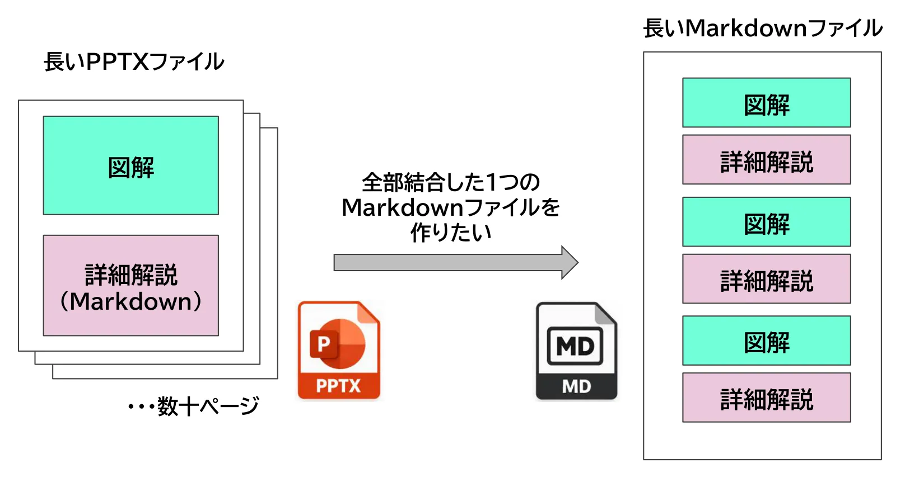
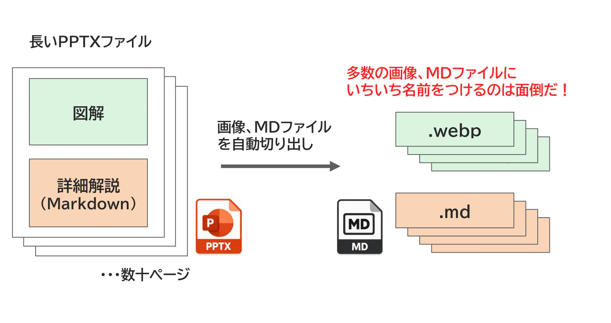
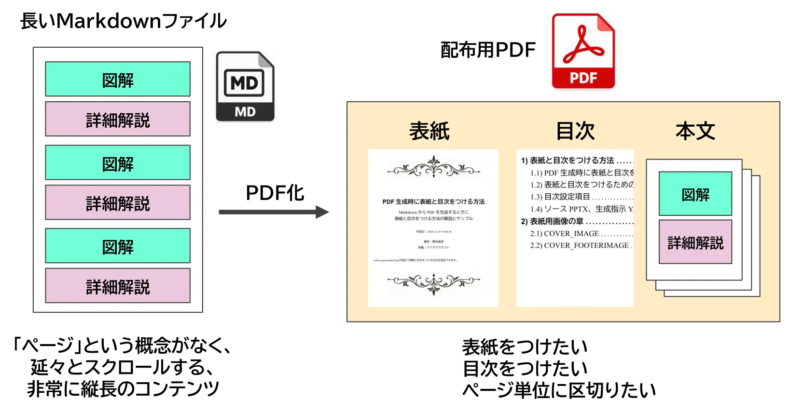
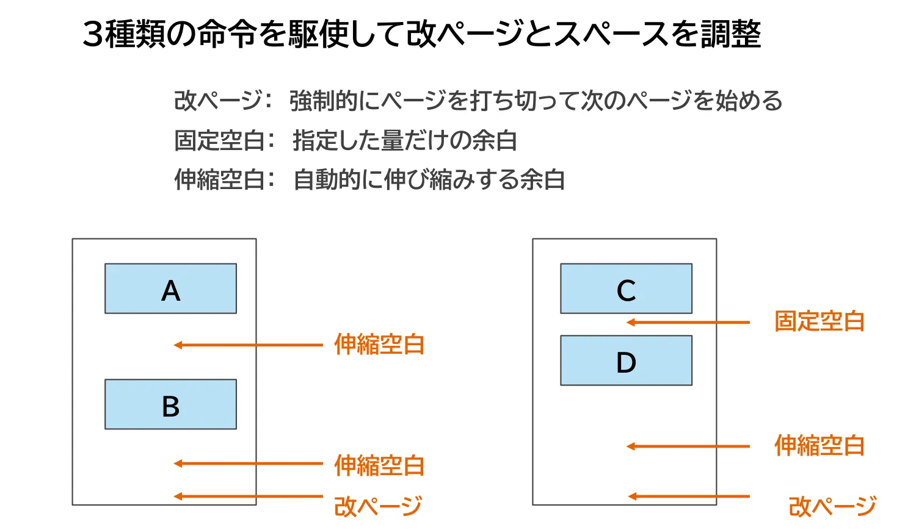
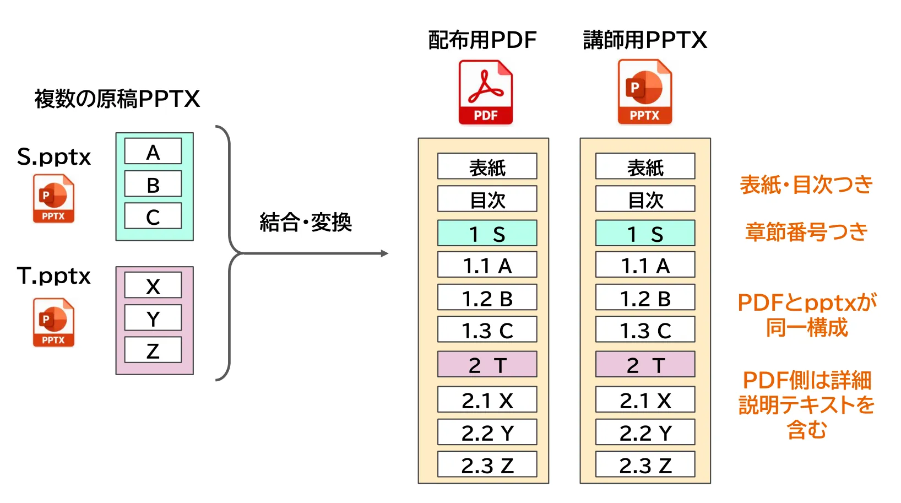
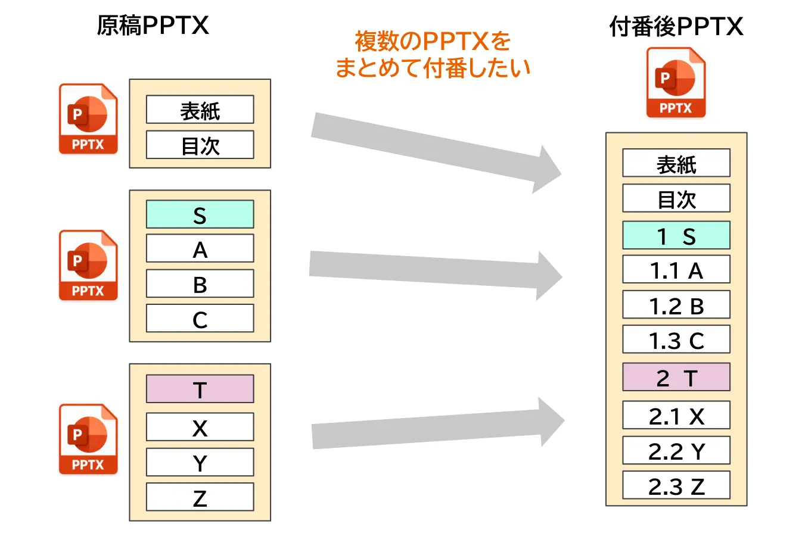

# ppt-md-merger 事例集

[ppt-md-merger](https://github.com/hiro77284/ppt-md-merger) を使って PowerPoint 原稿から PDF・Markdown などを作った事例を集めたリポジトリです。
ツール本体の使い方は本体リポジトリを参照してください。

各事例のフォルダには、原稿（pptx）と生成指示書（レシピ yaml）など **入力一式** と、生成結果を GitHub で読める形にした **事例ページ（README.md）** が入っています。
`src/` でレシピを実行すれば、PDF などの生成物はいつでも作り直せます。

## 事例一覧

<!-- BEGIN CASE INDEX -->
<!-- この部分は scripts/build_index.py が生成する。手で書き換えない。 -->

全 6 件

<table>
<tr><th width="400"></th><th>事例</th><th>概要</th><th>タグ</th><th>確認バージョン</th></tr>
<tr><td width="400"></td><td><a href="cases/100-slide-md/">pptxで画像＋Markdown一括制作</a><br><code>100-slide-md</code></td><td>スライドに画像を描き、noteにMarkdownを書いてそれを組み合わせた Markdown 原稿を自動生成する事例です。</td><td><code>markdown</code> <code>image-crop</code></td><td>2.0.6</td></tr>
<tr><td width="400"></td><td><a href="cases/101-special-variable/">画像ファイルとMDファイルの命名を自動化</a><br><code>101-special-variable</code></td><td>スライド番号を使って画像ファイルとMDファイルに自動的にスライドごとに違う名前を付与して、export命令をコピペで済ませる</td><td><code>export</code> <code>ファイル名</code></td><td>2.0.6</td></tr>
<tr><td width="400"></td><td><a href="cases/102-cover-index/">表紙と目次をつけてPDF生成</a><br><code>102-cover-index</code></td><td>PDF生成時に表紙と目次を付加する設定項目の解説</td><td><code>cover</code> <code>index</code></td><td>2.0.6</td></tr>
<tr><td width="400"></td><td><a href="cases/103-page-space/">PDF資料のページとスペースを調整する</a><br><code>103-page-space</code></td><td>PDF資料の改ページとコンテンツ間のスペースを調整する方法の解説とサンプル</td><td><code>page</code> <code>space</code></td><td>2.1.0</td></tr>
<tr><td width="400"></td><td><a href="cases/104-multi-pptx-merge/">複数の原稿PPTXをマージしてPDFおよび同一構成の単一PPTXを生成する</a><br><code>104-multi-pptx-merge</code></td><td>複数の原稿PPTXをマージして、章節構造で付番されたPDFと単一のPPTXを同じ構成で生成する方法の解説とサンプル</td><td><code>pptx</code> <code>merge</code> <code>pdf</code></td><td>2.1.0</td></tr>
<tr><td width="400"></td><td><a href="cases/105-pptx-numbering/">大きなPPTXファイルに章・節番号を付番する</a><br><code>105-pptx-numbering</code></td><td>ページ数の多いPPTXファイルに自動的に章・節番号を付番する方法の解説とサンプル</td><td><code>pptx</code> <code>numbering</code></td><td>2.1.2</td></tr>
</table>

### タグ別

- `cover` (1): [102-cover-index](cases/102-cover-index/)
- `export` (1): [101-special-variable](cases/101-special-variable/)
- `image-crop` (1): [100-slide-md](cases/100-slide-md/)
- `index` (1): [102-cover-index](cases/102-cover-index/)
- `markdown` (1): [100-slide-md](cases/100-slide-md/)
- `merge` (1): [104-multi-pptx-merge](cases/104-multi-pptx-merge/)
- `numbering` (1): [105-pptx-numbering](cases/105-pptx-numbering/)
- `page` (1): [103-page-space](cases/103-page-space/)
- `pdf` (1): [104-multi-pptx-merge](cases/104-multi-pptx-merge/)
- `pptx` (2): [104-multi-pptx-merge](cases/104-multi-pptx-merge/), [105-pptx-numbering](cases/105-pptx-numbering/)
- `space` (1): [103-page-space](cases/103-page-space/)
- `ファイル名` (1): [101-special-variable](cases/101-special-variable/)

<!-- END CASE INDEX -->

## 事例フォルダの中身

```
cases/NNN-slug/
├── case.yaml         事例のメタデータ（タイトル・概要・タグ・確認バージョンなど）。この一覧の元
├── README.md         事例ページ。ふつうは ppt_build --githubmd --transfer で生成する
├── readme-images/    README.md が参照する画像（transfer が書き出す）
├── thumbnail.png     一覧用のサムネイル（任意。case.yaml の thumbnail で別の画像も指定できる）
└── src/              入力一式: 原稿 pptx・レシピ yaml・COVER_VARS.yaml・表紙 md など
```

`images/`・`mds/`・`temppdfs/`・`build/` は `src/` のレシピを実行すると作られる生成物なので、リポジトリには入れません（`.gitignore` 済み）。
複数の事例で共通に使う設定は [`user_settings/`](user_settings/) に置き、レシピから `../../../user_settings/...` で参照します。

## ダウンロード

GitHub はフォルダ単位でダウンロードできないため、事例ごとの zip を Releases に置く予定です（事例が 10 件前後になったら GitHub Actions で自動化します）。
それまでは、リポジトリ全体を Code → Download ZIP で取得してください。

## 事例の追加

[CONTRIBUTING.md](CONTRIBUTING.md) を参照してください。
