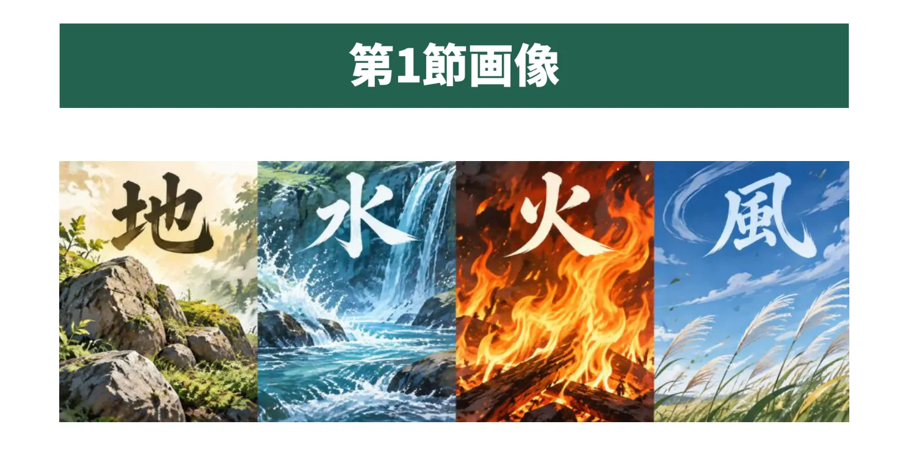
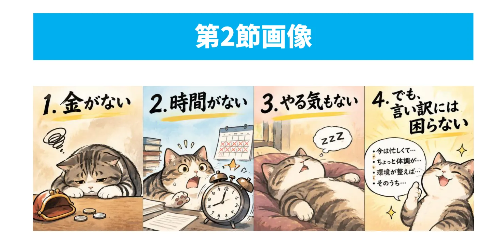
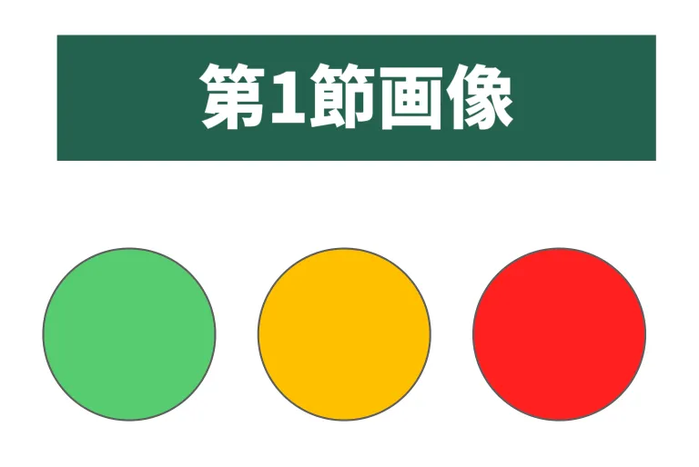
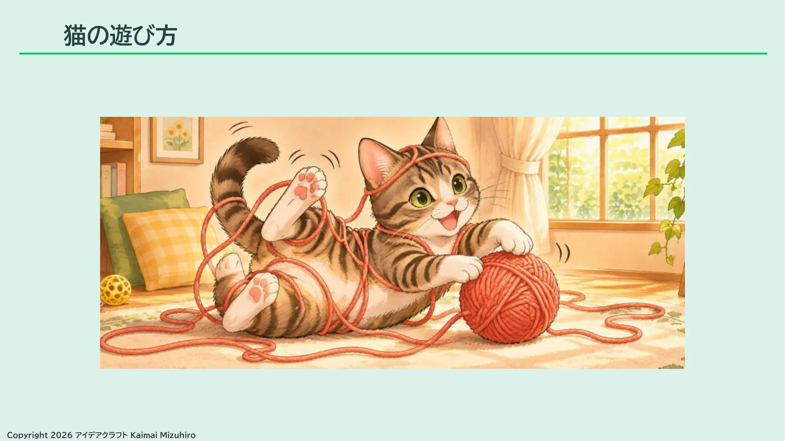

<!-- source: ../mds/TEMPLATE_slide1.md -->
<!-- md_merge_rawtitle: 章とびら1 -->
<!-- #id:chapter:TEMPLATE:slide1 -->
# 1) 章とびら1

> このスライドは章とびらになります。sectionlistは章の節リストに変換されます。
>
> 章番号は自動付与されます。

> - 1.1) 地水火風
> - 1.2) カネ・時間・やる気・言い訳

<!-- source: ../mds/TEMPLATE_slide2.md -->
<!-- md_merge_rawtitle: 地水火風 -->
<!-- #id:section:TEMPLATE:slide2 -->
## 1.1) 地水火風

第1節の文章サンプル。　詳細説明テキストはこのようにnote部分にMarkdownテキストで書けます。

節番号は自動付与されます。

スライド画像を含められます。

{ width=80% }

箇条書きも使えます。

> **BLOCKINDENT**
>
> - 地：地に足をつけて、堅実に進め。
> - 水：水のように、柔軟に変化せよ。
> - 火：火のように、情熱を燃やせ。
> - 風：風のように、自由に駆け抜けろ。

<!-- source: ../mds/TEMPLATE_slide3.md -->
<!-- md_merge_rawtitle: カネ・時間・やる気・言い訳 -->
<!-- #id:section:TEMPLATE:slide3 -->
## 1.2) カネ・時間・やる気・言い訳

第2節の文章サンプルです。　

{ width=80% }

> **BLOCKINDENT**
>
> - 金がない
> - 時間がない
> - やる気もない
> - でも、言い訳には困らない

<!-- source: ../mds/TEMPLATE_slide4.md -->
<!-- md_merge_rawtitle: 章とびら2 -->
<!-- #id:chapter:TEMPLATE:slide4 -->
# 2) 章とびら2

> このスライドは章とびらになります。sectionlistは章の節リストに変換されます。

> - 2.1) 交通信号
> - 2.2) 猫の遊び方

<!-- source: ../mds/TEMPLATE_slide5.md -->
<!-- md_merge_rawtitle: 交通信号 -->
<!-- #id:section:TEMPLATE:slide5 -->
## 2.1) 交通信号

交通信号画像の配色。

{ width=40% }

小さい画像を使った例です

<!-- source: ../mds/TEMPLATE_slide6.md -->
<!-- md_merge_rawtitle: 猫の遊び方 -->
<!-- #id:section:TEMPLATE:slide6 -->
## 2.2) 猫の遊び方

スライド全体をまるごと画像化する例です。

{ width=90% }

