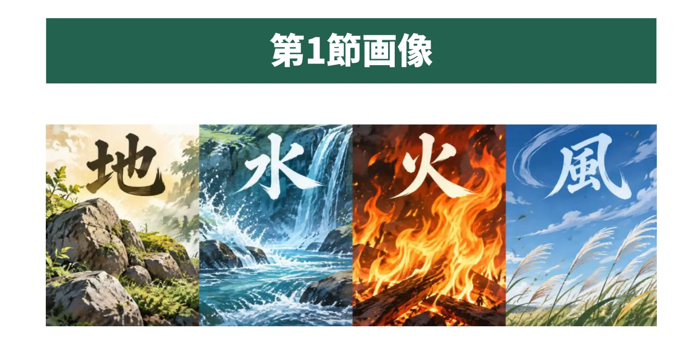

<!-- md_merge_rawtitle: 地水火風 -->
{{#id:section:TEMPLATE:slide2}}
## 地水火風

第1節の文章サンプル。　詳細説明テキストはこのようにnote部分にMarkdownテキストで書けます。

節番号は自動付与されます。

スライド画像を含められます。

{{vspace:1}}

::: {.center}
{ width=80% }
:::

{{vspace:1}}

箇条書きも使えます。

::: {.blockindent indent=2em}
- 地：地に足をつけて、堅実に進め。
- 水：水のように、柔軟に変化せよ。
- 火：火のように、情熱を燃やせ。
- 風：風のように、自由に駆け抜けろ。
:::