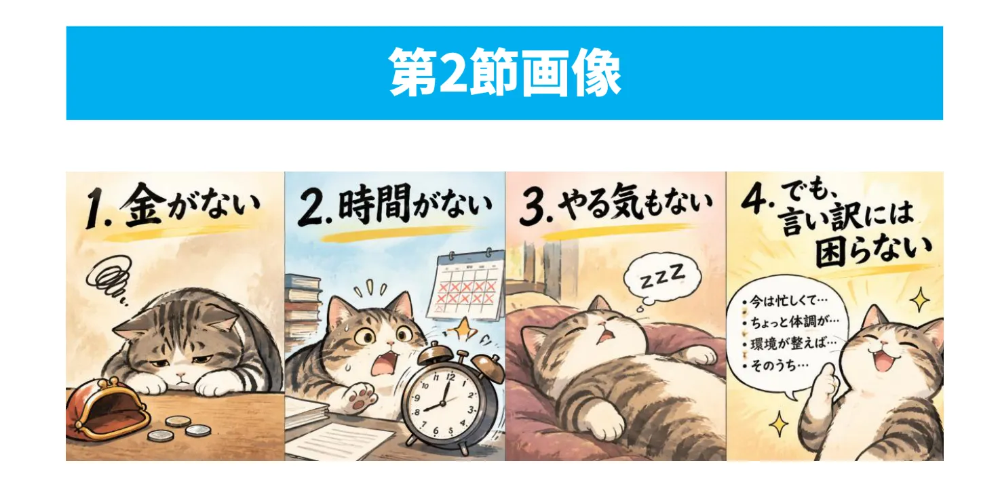

<!-- md_merge_rawtitle: カネ・時間・やる気・言い訳 -->
{{#id:section:TEMPLATE:slide3}}
## カネ・時間・やる気・言い訳

第2節の文章サンプルです。　

{{vspace:1}}

::: {.center}
{ width=80% }
:::

{{vspace:1}}

::: {.blockindent indent=2em}
- 金がない
- 時間がない
- やる気もない
- でも、言い訳には困らない
:::