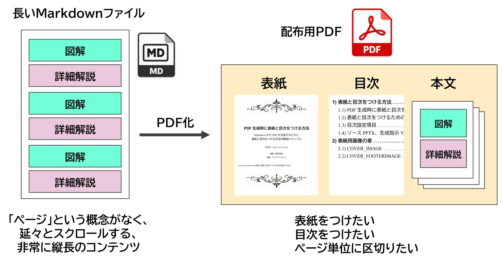
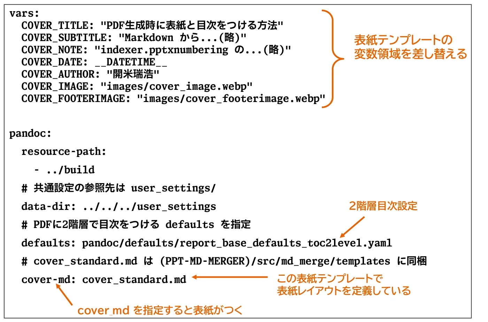
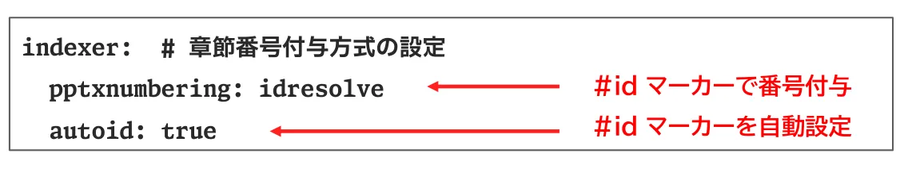
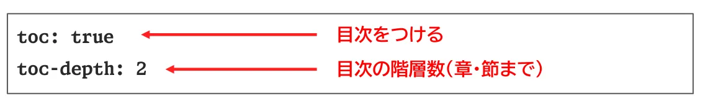
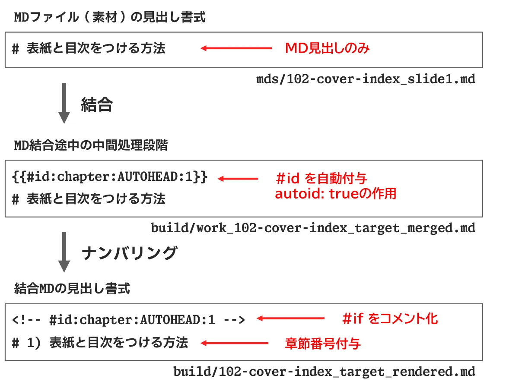
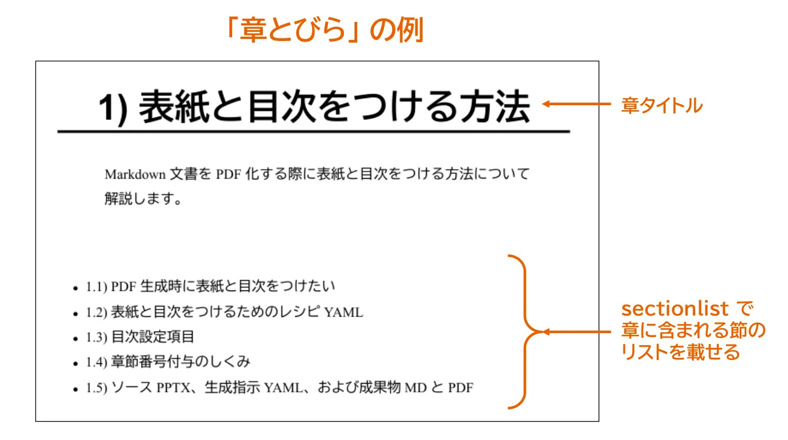
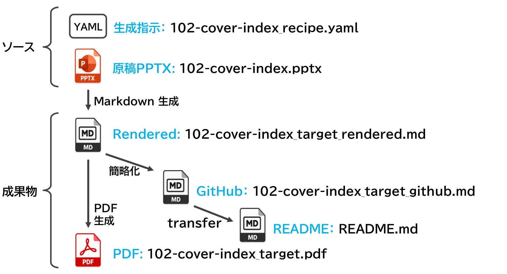

<!-- source: ../mds/102-cover-index_slide1.md -->
<!-- md_merge_rawtitle: 表紙と目次をつける方法 -->
<!-- #id:chapter:AUTOHEAD:1 -->
# 1) 表紙と目次をつける方法

> Markdown文書をPDF化する際に表紙と目次をつける方法について解説します。


> - 1.1) PDF生成時に表紙と目次をつけたい
> - 1.2) 表紙と目次をつけるためのレシピYAML
> - 1.3) 目次設定項目
> - 1.4) 章節番号付与のしくみ
> - 1.5) 「章とびら」 のしくみ
> - 1.6) 生成処理の実行
> - 1.7) ソースPPTX、生成指示YAML、および成果物MDとPDF


<!-- source: ../mds/102-cover-index_slide2.md -->
<!-- md_merge_rawtitle: PDF生成時に表紙と目次をつけたい -->
<!-- #id:section:AUTOHEAD:2 -->
## 1.1) PDF生成時に表紙と目次をつけたい

たとえば集合研修やイベント講演時にテキスト/資料を配付するときなど、Markdownファイルのままで読者に見てもらうのではなく、印刷して紙媒体で、あるいはPDF化して配付したい場合があります。 

PDF形式なら印刷もすぐできますから、 「とりあえずPDF化」 だけでもいいのですが、このときに 「表紙と目次をつけたいなあ・・・」 ということがよくあります。


Markdown にはページという概念がなく、延々とスクロールする縦長のコンテンツであり、リンクを使って自由にジャンプできるし検索もできるのに対して、紙媒体ではリンクも検索も効きません。そのため長くなればなるほど目次が重要であり、 紙はページ単位ですので目次を付けるためにはページの管理が必要です。 また、表紙と目次があるだけでも文書の信頼性は一段階上がるものです。





つまり、

- 表紙をつけたい
- 目次をつけたい
- ページ単位に区切りたい

というニーズがあります。 3つめは実際に技術解説テキストのような教材を作ってみるとわかりますが、できるだけコンテンツを小テーマごとにページ単位で完結するように作りたくなるのです。そのほうが読者の脳に余計な負担を掛けずに済むからです。 そのため、PDF化の際にページ区切りを調整する必要があります。そこで ppt-md-merger にはこれらの機能を持たせています。　当サンプルでは表紙と目次の付与について解説します。 ページ区切りについては別サンプルで扱います。


<!-- source: ../mds/102-cover-index_slide3.md -->
<!-- md_merge_rawtitle: 表紙と目次をつけるためのレシピYAML -->
<!-- #id:section:AUTOHEAD:3 -->
## 1.2) 表紙と目次をつけるためのレシピYAML

表紙と目次をつけるには、レシピYAMLに必要項目を設定します。




vars: は任意の変数を定義するセクションで、 COVER_* 変数は表紙テンプレート用の変数です。この内容を書き換えると表紙の文言が変わります。

report_base_defaults_toc2level.yaml はPDF生成に使用する文書変換プログラム、Pandoc 関係の標準設定ファイルで、２階層（章・節レベルまで）の目次を作る設定を含むものです。

この種の設定項目は複数の文書で共通になることが多いため、通常は文書とは別のフォルダに共通設定ファイルとしてまとめておき、複数の文書レシピYAMLから参照できるようにします。その共通設定フォルダが data-dir: で、その中の defaults: が Pandoc設定ファイルです。

表紙をつけるには cover_md: を設定します。 cover_standard.md は ppt-md-merger 同梱のシンプルな表紙レイアウトです。 COVER_* 変数は、この cover_standard.md の中で参照されます。 独自の表紙レイアウトを作る際はこのファイルをコピーして修正するとよいでしょう。


<!-- source: ../mds/102-cover-index_slide4.md -->
<!-- md_merge_rawtitle: 目次設定項目 -->
<!-- #id:section:AUTOHEAD:4 -->
## 1.3) 目次設定項目

レシピYAML内の章節番号付与方式設定部分です。

pptxnumbering: "idresolve" は、 MD ファイル中の #id マーカーを認識して章節番号を付与します。

autoid: "true" は、MDファイル中の #, ##, ### 見出しに自動的に #id マーカーを付与します。





data-dir: と defaults: で参照する pandoc 設定ファイル、report_base_defaults_toc2level.yaml 内の目次設定項目です。

toc: true で目次あり、falseで目次なしです。

toc-depth: は目次の階層数です。数字を大きくすると、より深い目次（小さな項目まで含む目次）を作ります。





<!-- source: ../mds/102-cover-index_slide5.md -->
<!-- md_merge_rawtitle: 章節番号付与のしくみ -->
<!-- #id:section:AUTOHEAD:5 -->
## 1.4) 章節番号付与のしくみ

この章節番号付与のしくみは以下のようなものです。 原稿pptx から切り出された素材MD(mds/102-cover-index_slide1.md) の段階ではMD見出しのみがあり、番号はついていません。

次に結合処理の途中で(build/work_102-cover-index_target_merged.md)、#, ##, ### の各レベルの見出しに #id を自動付与します。これは autoid: true の作用です。
なお、work_102-cover-index_target_rendered.md というファイルはMD結合処理の途中で生成される作業用ファイルで、すぐに削除されるため通常はビルドの中には残りません。pptmdmerge コマンド実行時に --keep-work というオプションをつけると削除されずに残ります。

その後、この #id を解析して章節番号を付与します。 最終的に生成される結合MD(build/102-cover-index_target_rendered.md)では、#id がコメント化されてMDビューアーやPDF上では見えなくなる一方、見出しには "# 1) 表紙" のように番号が付与されています。





これが pptxnumbering: idresolve と autoid: true の効果です。 MDの章節番号を手打ちするのは加筆や削除に弱いのですが、この方式なら自動付与なので手間が省けます。


<!-- source: ../mds/102-cover-index_slide6.md -->
<!-- md_merge_rawtitle: 「章とびら」 のしくみ -->
<!-- #id:section:AUTOHEAD:6 -->
## 1.5) 「章とびら」 のしくみ

章ごとに先頭に 「章とびら」 という独立ページをつけて、その章の概要と、含まれる節のリストを載せると、プロが編集した書籍のように見えるし読みやすくもなります。

ppt-md-merger には章とびらを作るための sectionlist という機能があります。

実際に作られる章とびらの例が下記です。





このようなとびらページを作るには、MD上の 見出しレベルを最上位 '#' にします。 通常のコンテンツは '##' で記述しますが、 '#' を使うとページ自体のレイアウトが変わり、章とびら用のレイアウトになってタイトル部分が中央に大きく表示されます。

節リストを表示するには MDテキスト中に

```
{{sectionlist}}
```

と書きます。具体例は当サンプルの原稿PPTXを開いて、章とびらに該当するページの note を確認してください。


<!-- source: ../mds/102-cover-index_slide7.md -->
<!-- md_merge_rawtitle: 生成処理の実行 -->
<!-- #id:section:AUTOHEAD:7 -->
## 1.6) 生成処理の実行

以下の命令で生成を実行します。サブコマンド ppt_build の引数に生成指示書を指定します。


```bash
cd cases\102-cover-index\src
pptmdmerge ppt_build 102-cover-index_recipe.yaml --github --pdf --transfer
```


「WARNING: YAML ファイルが見つかりません」 という警告は出ても問題ありません。

この命令で生成されるのは renderedfilename で指定する Rendered MD です。

オプションを追加すると、PDFやGitHubMDも生成します。


```bash
cd cases\102-cover-index\src
pptmdmerge ppt_build 102-cover-index_recipe.yaml --pdf --github --transfer
```


**オプションなし** Rendered MD のみ生成する

**--pdf** Rendered MD をもとにPDFを生成する

**--github** Rendered MD をもとにGitHub用MDを生成する

**--transfer** 生成したMDを他の場所に転送するオプション。当サンプルでは、GitHubMD をもとに README.md を作るために使用する。

Rendered, PDF, GitHubMD 等の関係については次項の図をご覧ください。


<!-- source: ../mds/102-cover-index_slide8.md -->
<!-- md_merge_rawtitle: ソースPPTX、生成指示YAML、および成果物MDとPDF -->
<!-- #id:section:AUTOHEAD:8 -->
## 1.7) ソースPPTX、生成指示YAML、および成果物MDとPDF

当サンプルのソースと成果物を以下のリンクで確認できます。

<!-- #id:subsection:AUTOHEAD:9 -->
### 1.7.1) ソース

**生成指示** [102-cover-index_pdf_recipe.yaml](src/102-cover-index_recipe.yaml)

**原稿PPTX** [102-cover-index.pptx](src/102-cover-index.pptx)


<!-- #id:subsection:AUTOHEAD:10 -->
### 1.7.2) 成果物

MDは何種類か異なる仕様で生成します。 Rendered MDはPPTXソースから切り出したMDにさまざまな加工を加えた生成物で、豊富な書式指示を含んでいます。 それらの書式指示をすべて落として GitHub での表示に特化したのがGitHub用MDです。

**Rendered MD** [102-cover-index_target_rendered.md](build/102-cover-index_target_rendered.md)

**GitHub用MD** [102-cover-index_target_github.md](build/102-cover-index_target_github.md)

**PDF** [102-cover-index_target.pdf](build/102-cover-index_target.pdf)

**README** このファイルです



当サンプルはPDF化時に表紙・目次・章節番号を自動付与するサンプルですので、「PDF」 のpdfを開いてそれらの状態を確認し、次いで 生成指示YAMLを開いて vars: と cover-md:, defaults: , indexer: を確認してください。 また、原稿PPTXを開いて章とびらページのMDテキスト、表紙用画像の章を確認してください。


<!-- source: ../mds/102-cover-index_slide9.md -->
<!-- md_merge_rawtitle: 表紙用画像の章 -->
<!-- #id:chapter:AUTOHEAD:11 -->
# 2) 表紙用画像の章

> この章は表紙用画像制作用で、本文のコンテンツとしては不要なパートですが、章・節番号を付与して目次をつけるサンプルとしては意味があるので、PDFにも掲載しておきます。


> - 2.1) COVER_IMAGE
> - 2.2) COVER_FOOTERIMAGE


<!-- source: ../mds/102-cover-index_slide10.md -->
<!-- md_merge_rawtitle: COVER_IMAGE -->
<!-- #id:section:AUTOHEAD:12 -->
## 2.1) COVER_IMAGE

表紙上部に載せたい画像をこのスライドで制作し、cover_image.webp という名前で切り出します。
そのファイルをレシピYAMLの COVER_IMAGE: 変数で指定すると、表紙上部に差し込まれます。


<!-- source: ../mds/102-cover-index_slide11.md -->
<!-- md_merge_rawtitle: COVER_FOOTERIMAGE -->
<!-- #id:section:AUTOHEAD:13 -->
## 2.2) COVER_FOOTERIMAGE

表紙上部に載せたい画像をこのスライドで制作し、cover_footerimage.webp という名前で切り出します。
そのファイルをレシピYAMLの COVER_FOOTERIMAGE: 変数で指定すると、表紙下部に差し込まれます。


