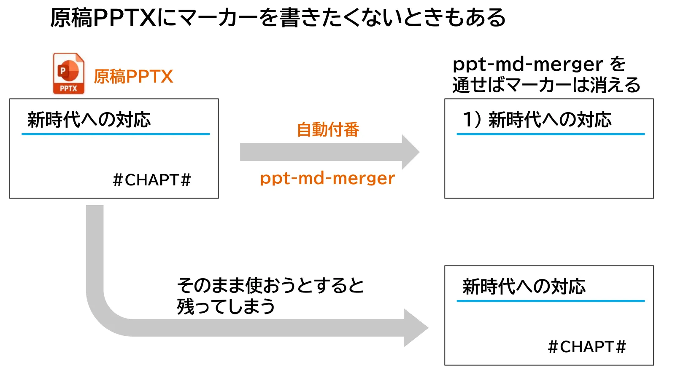
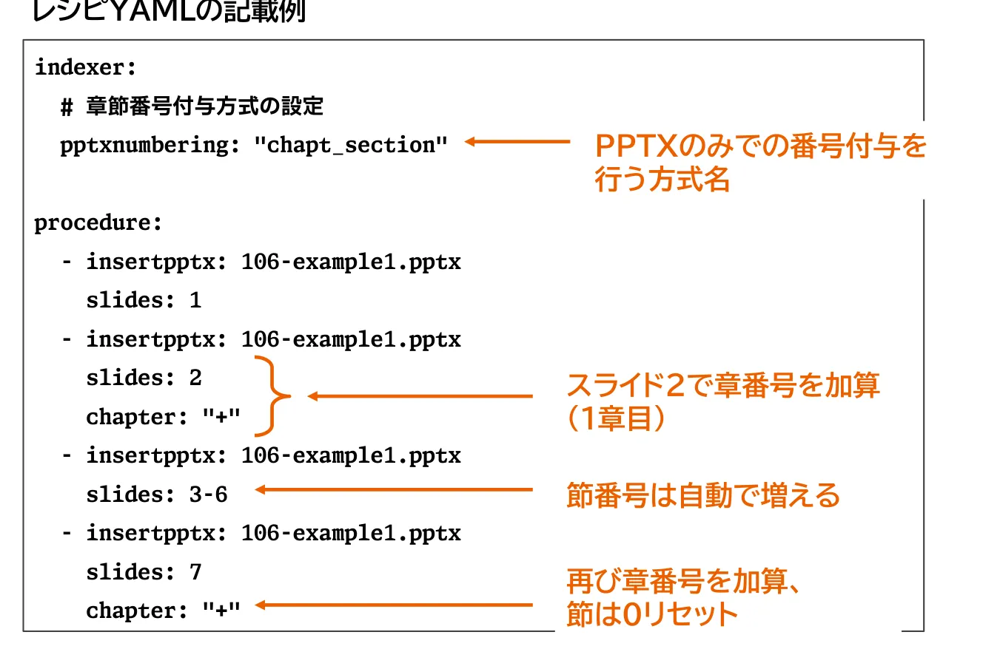
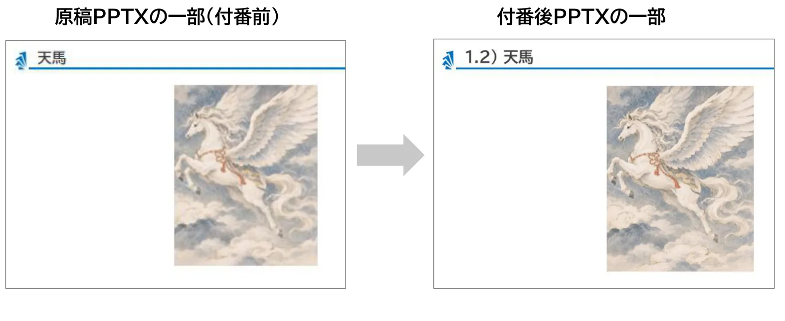
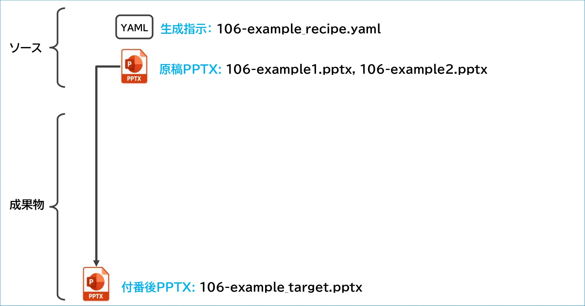

<!-- source: ../mds/106-numbering-by-procedure_slide1.md -->
<!-- md_merge_rawtitle: procedureによる章節番号制御 -->
<!-- #id:chapter:106-numbering-by-procedure:slide1 -->
# 1) procedureによる章節番号制御

> PPTXにCHAPT, SECTIONマーカーを書けない、あるいは書きたくない場合に、レシピYAMLのprocedure側で章節番号を制御する方法を解説します。


> - 1.1) PPTXにマーカーを書きたくない
> - 1.2) PPTXのみの番号付与を行うレシピYAML
> - 1.3) 生成処理の実行
> - 1.4) ソースPPTX、生成指示YAML、および成果物PPTX


<!-- source: ../mds/106-numbering-by-procedure_slide2.md -->
<!-- md_merge_rawtitle: PPTXにマーカーを書きたくない -->
<!-- #id:section:106-numbering-by-procedure:slide2 -->
## 1.1) PPTXにマーカーを書きたくない

PPTXに章節番号をつけるためにCHAPTやSECTIONマーカーを書くと、ppt-md-mergerを通さないときはそれが残ってしまうので困る、という場合があります。　その場合の対処法はおおきく3つあります。

- マーカーを非常に小さく目立たないように書く
- マーカーの文字色を消して見えないようにする
- マーカーを使わず procedure で制御する

1，2は結局マーカーを書く方法ですが、3番目はPPTXスライドそのものには何も手をつけません。 当サンプルはその方法を解説します。





<!-- source: ../mds/106-numbering-by-procedure_slide3.md -->
<!-- md_merge_rawtitle: PPTXのみの番号付与を行うレシピYAML -->
<!-- #id:section:106-numbering-by-procedure:slide3 -->
## 1.2) PPTXのみの番号付与を行うレシピYAML

PPTXのみの番号付与を行うレシピYAMLの例です。 procedure で insertpptx をするときに、chapter: "+" を付記すると、#CHAPTER# と同等の効果を持ちます。





その他、下記のような記法が使えます。

**section: "+"**   SECTIONマーカーと同じ。ただしこれは省略時と同じ動作。

**subsection: "+"**   SUBSECTIONマーカーと同じ

**chapter: "2"**   chapterを指定の数字にセットする。section, subsection でも同様

**stay: true** trueまたはfalse。true でSTAYマーカーと同じ

**nonumbering: true** trueまたはfalse。true でNONUMBERINGマーカーと同じ

これらをすべて省略した時は **section: "+"** を指定したのと同じになります。通常、節番号を自動で増やしていく用法が最も多いため、省略可能にしてあります。これも スライド側のマーカー省略時は SECTION が自動で増えるのと同じ仕様です。


<!-- source: ../mds/106-numbering-by-procedure_slide4.md -->
<!-- md_merge_rawtitle: 生成処理の実行 -->
<!-- #id:section:106-numbering-by-procedure:slide4 -->
## 1.3) 生成処理の実行

以下の命令で生成を実行します。 このサンプルでは chapt_section 方式の PPTX のみの生成を行うので、サブコマンドは pptmerge です。


```bash
cd cases\106-numbering-by-procedure\src
pptmdmerge pptmerge 106-example_recipe.yaml
```


付番前と付番後のPPTXファイルの一部を示します。





<!-- source: ../mds/106-numbering-by-procedure_slide5.md -->
<!-- md_merge_rawtitle: ソースPPTX、生成指示YAML、および成果物PPTX -->
<!-- #id:section:106-numbering-by-procedure:slide5 -->
## 1.4) ソースPPTX、生成指示YAML、および成果物PPTX

当サンプルのソースと成果物を以下のリンクで確認できます。

### ソース

**生成指示** [106-example_recipe.yaml](src/106-example_recipe.yaml)

**原稿PPTX** [106-example1.pptx](src/106-example1.pptx), [106-example2.pptx](src/106-example2.pptx)


### 成果物

当サンプルはPPTXの生成のみを行い、MDやPDFは生成しません。 

**付番後PPTX** [106-example_target.pptx](build/106-example_target.pptx)

**README** 今、あなたがGitHubで読んでいるこのファイルです



原稿PPTXと付番後PPTXを開き、レシピYAMLのprocedure記述と照らし合わせて確認してください。

また、原稿PPTXにはnoteが書かれていないことも確認してください。

複数の原稿PPTXが結合されて、それらが続き番号として一貫した付番が行われていることを確認してください。