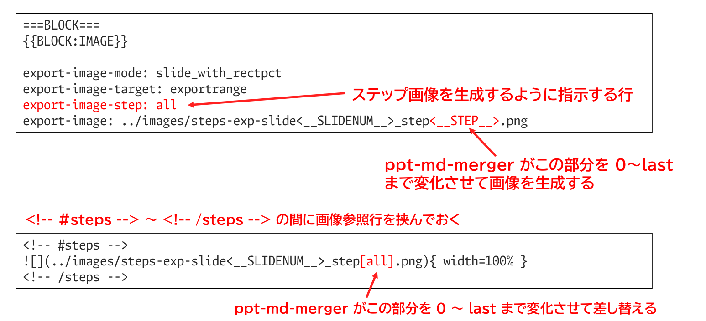

<!-- md_merge_rawtitle: ステップ表示アニメーションを レシプロマーカーで使う方法 -->
{{#id:section:マルチステップ機能:slide2}}
## ステップ表示アニメーションを レシプロマーカーで使う方法

PowerPoint の 「要素を順番に表示していく」 単純なアニメーション機能を Markdown 文書で
使うことができます。 これをMULTISTEP機能と言います。
以下、そのデータを作るための ppt-md-merger 記述の例です。

{{vspace:1}}

{ width=100% }

{{vspace:1}}

次ページ以降に実際の使用例を掲載します。ページ送り操作（カーソル右、スペース、→ボタンなど）をすると、画像部分が差し替わります。