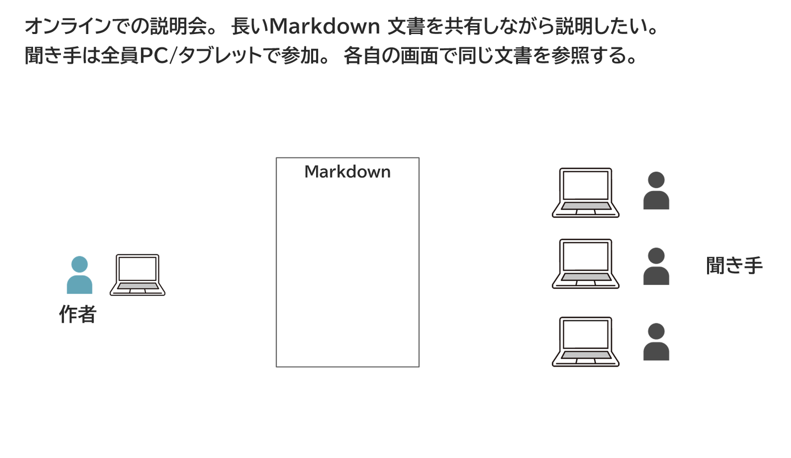
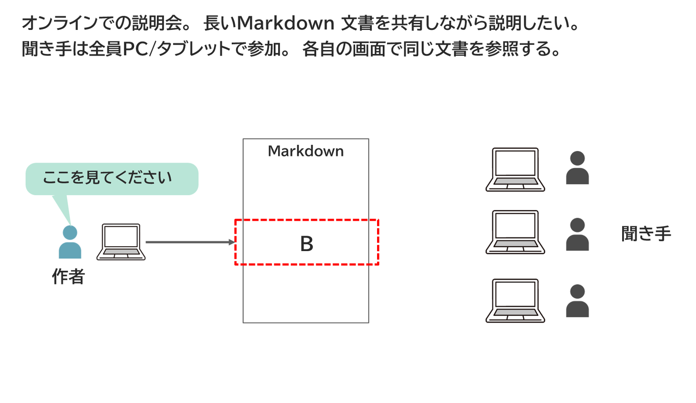
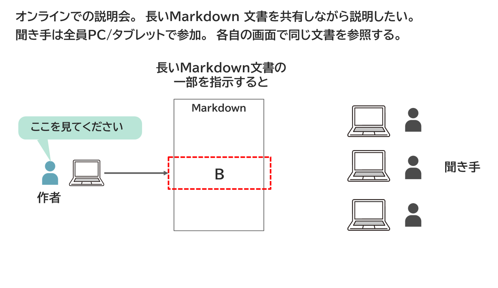
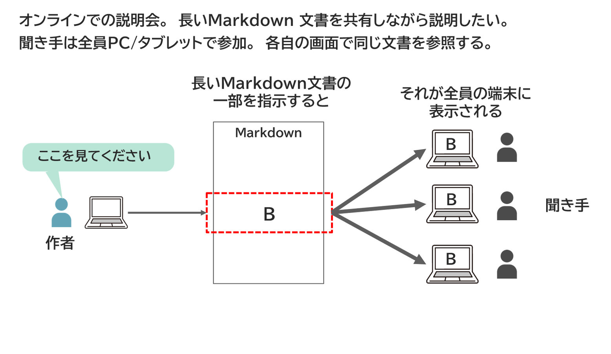
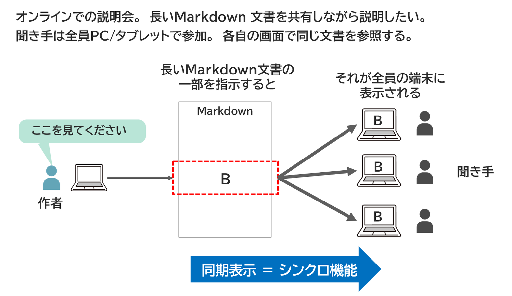

<!-- md_merge_rawtitle: Markdown長文のオンライン説明に役立つシンクロ機能 -->
{{#id:section:マルチステップ機能:slide3}}
## Markdown長文のオンライン説明に役立つシンクロ機能

近年、Markdown形式文書の用途が広がっています。

技術文書、社内ナレッジ、Wiki、議事録、調査メモ、ブログ記事、講義ノート、教材、長めの解説文書などに使われることが多いですね。

そこで、こんなことをしたくなるわけです。

:::{.center}
<!-- #steps -->
{ width=100% }
{ width=100% }
{ width=100% }
{ width=100% }
{ width=100% }
<!-- /steps -->
:::

社内ナレッジをMarkdownで書いて、それをシェアするためにチーム内で口頭説明を加えるような場面です。

そんなとき、聞き手は全員各自の端末でMarkdownファイルを開いて、「ここを見てください」 という作者の指示を聞きながらミーティングを進めるわけです。

場合によっては全員社内に出社しているのに、ZoomやTeamsでオンライン会議しながらこれをやっていることもありますね。

そんなとき、作者が 「ここを見て」 と指示した、同じ部分が全員の端末に同期して表示されてほしいですね。　つまり 「シンクロ機能」 です。