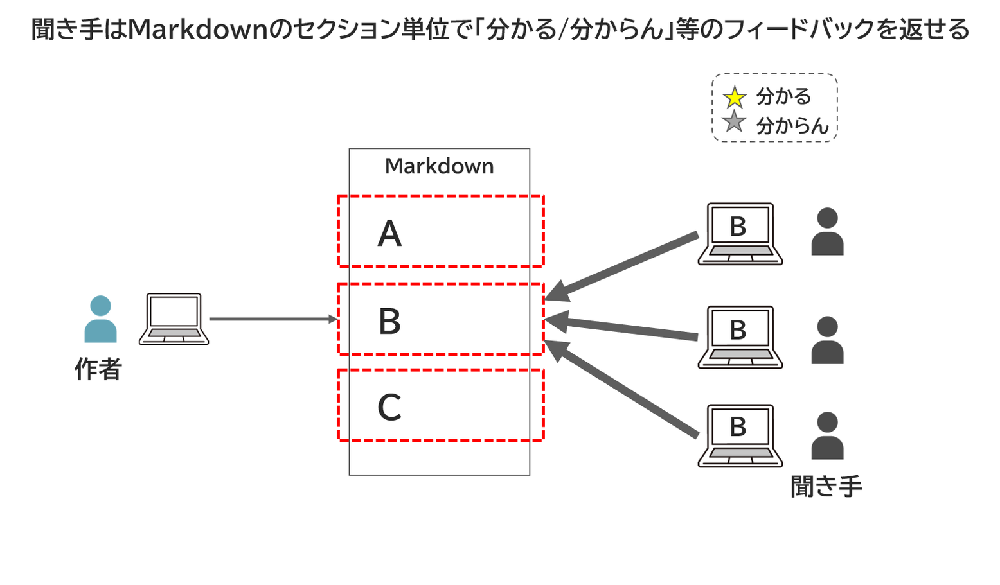
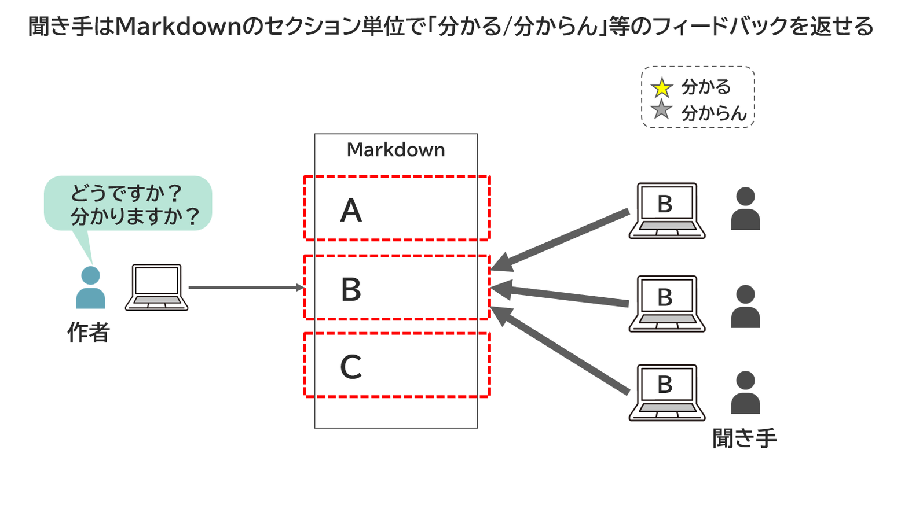
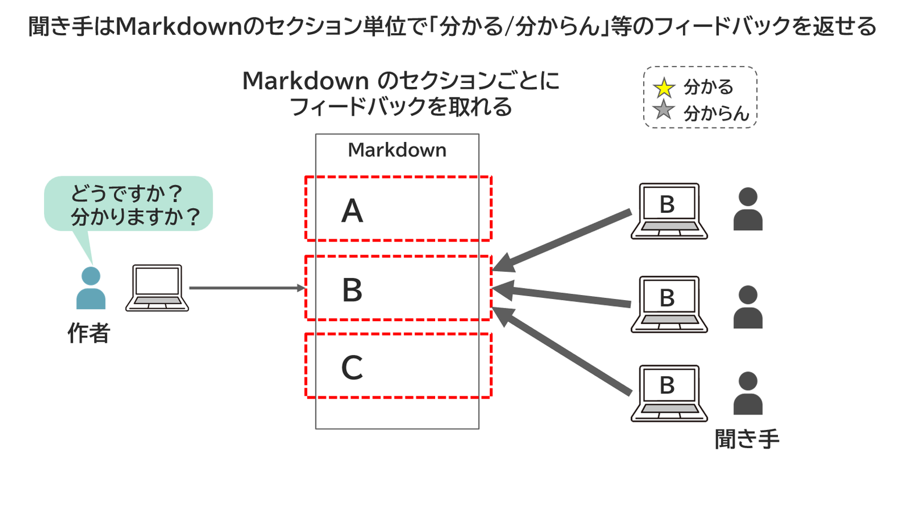
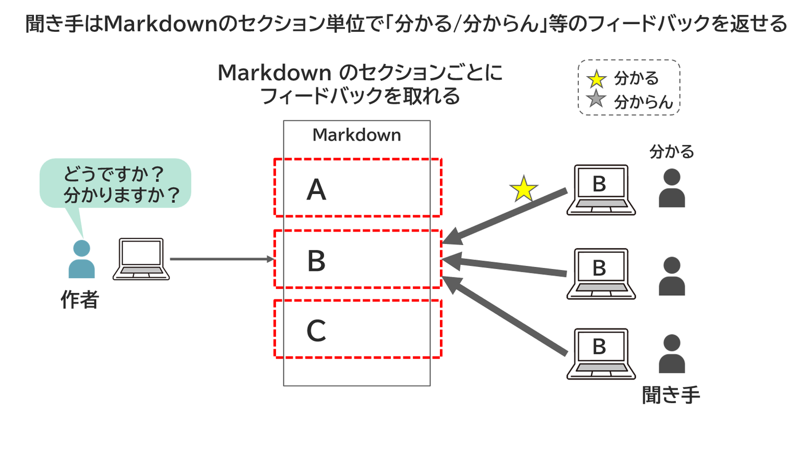
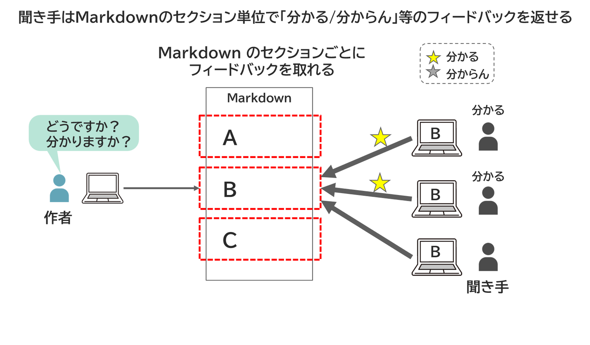
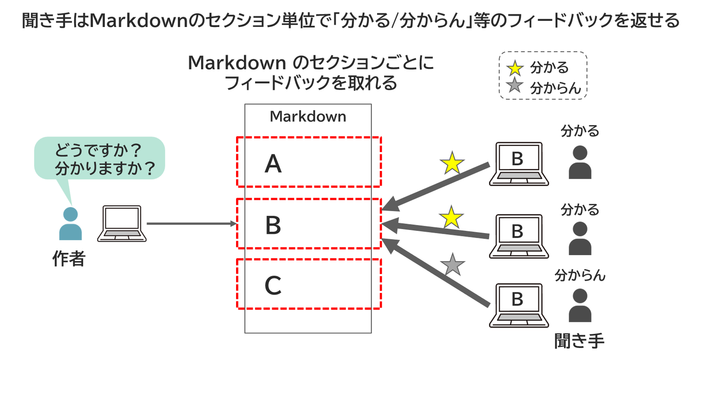
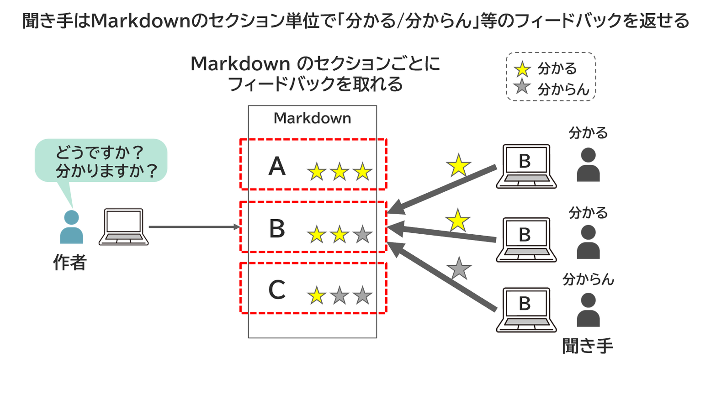
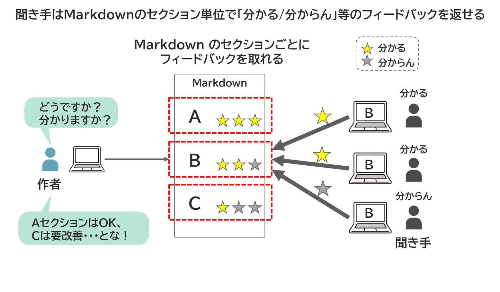
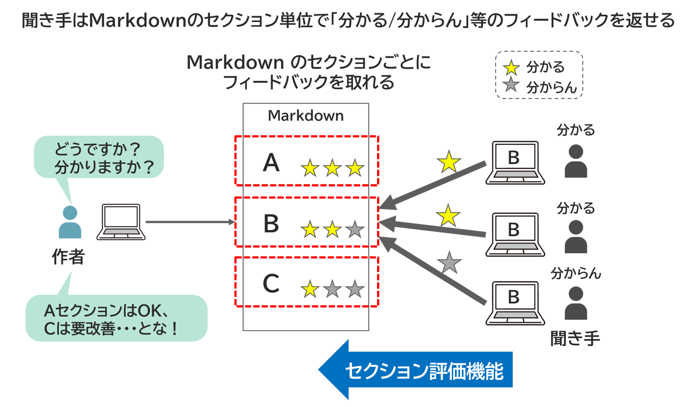

<!-- md_merge_rawtitle: セクション単位でフィードバックが欲しい -->
{{#id:section:マルチステップ機能:slide4}}
## セクション単位でフィードバックが欲しい

さらに、Markdown文書の中身は #, ## などの見出しでセクション分割できるので、そのようなセクションごとに 「分かる」「分からん」 といったフィードバックが取れると便利です。

「おっ、このセクションだけ理解度低いなあ。　ここを直す必要があるのか」 ということがわかります。

<!-- #steps -->
{ width=100% }
{ width=100% }
{ width=100% }
{ width=100% }
{ width=100% }
{ width=100% }
{ width=100% }
{ width=100% }
{ width=100% }
<!-- /steps -->

全体に対しておおまかに 「いいね」 と言ってもらうのではなく、 「どこを直すべきなのか、ピンポイントで特定したい」 という場面、ありますよね？　それには、こんなセクション単位のフィードバックが必要です。　これは 「セクション評価機能」 と呼びましょう。