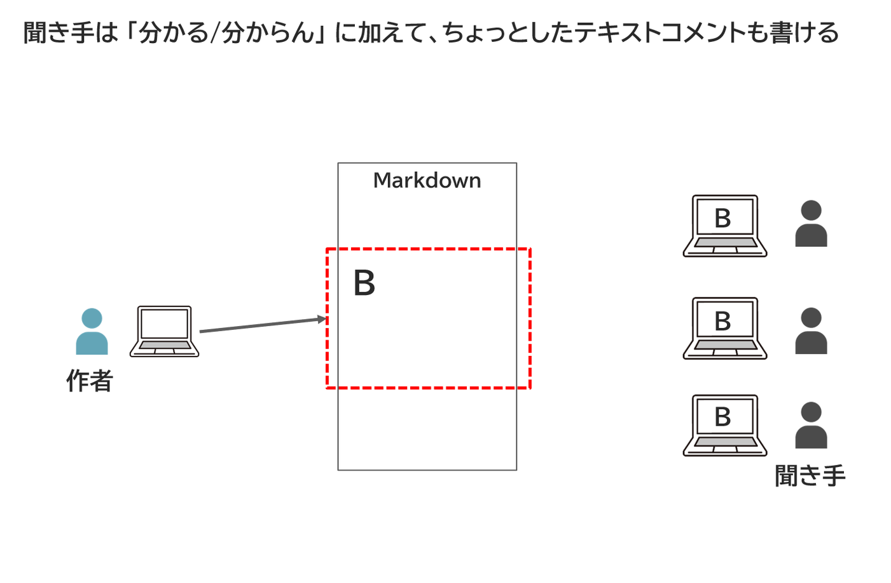
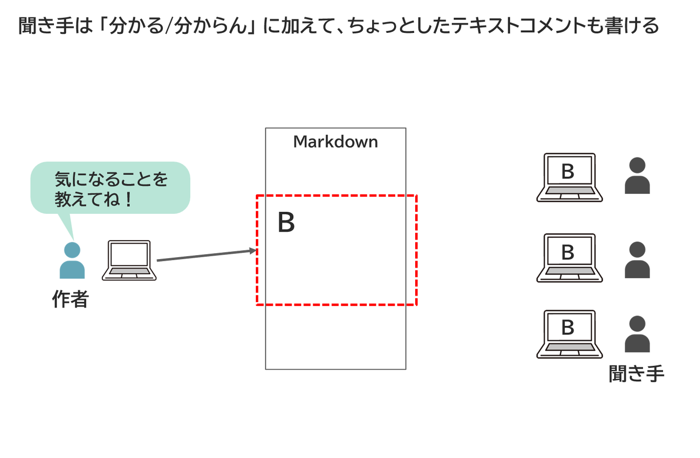
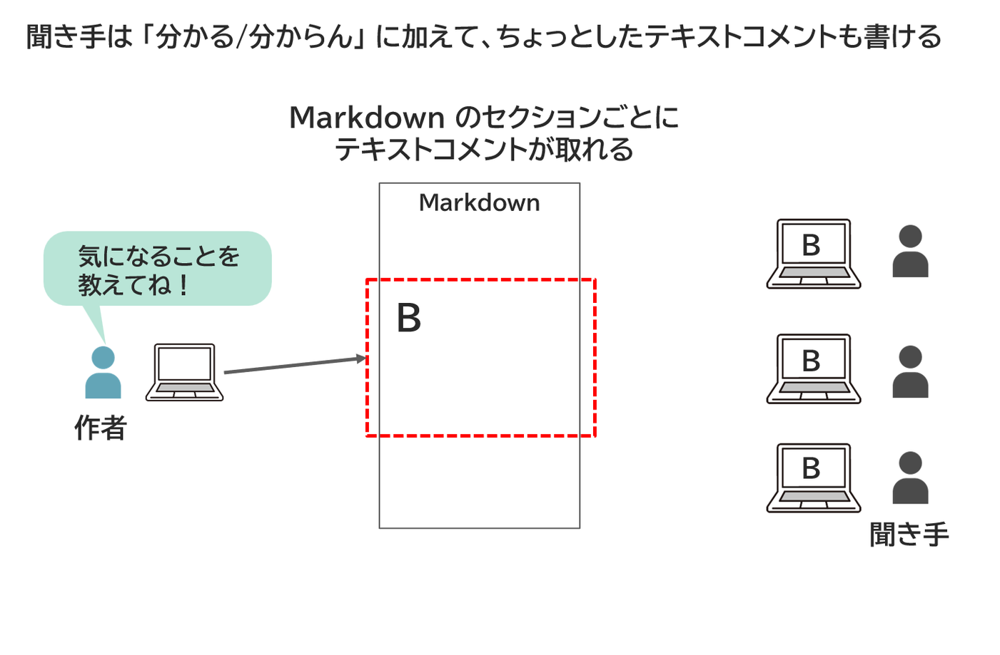
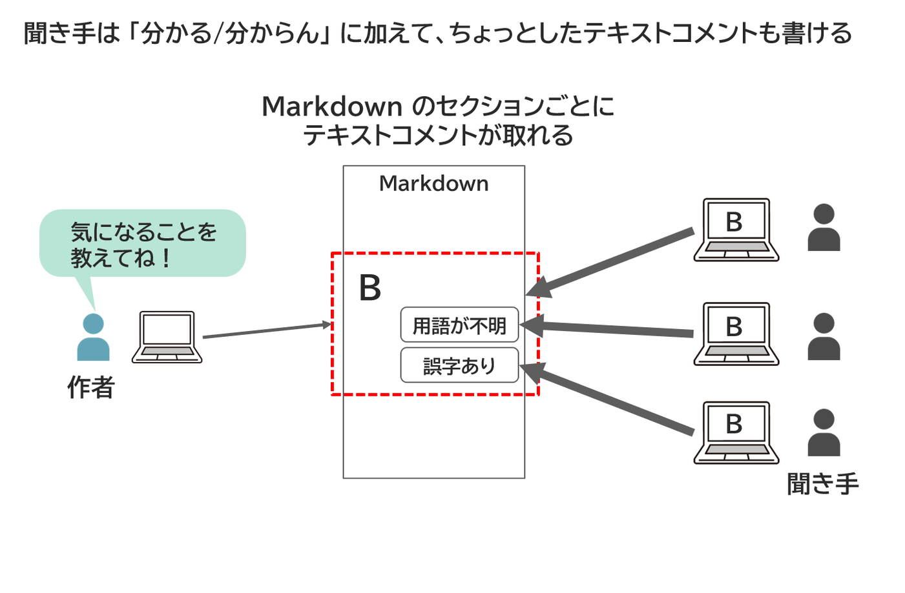
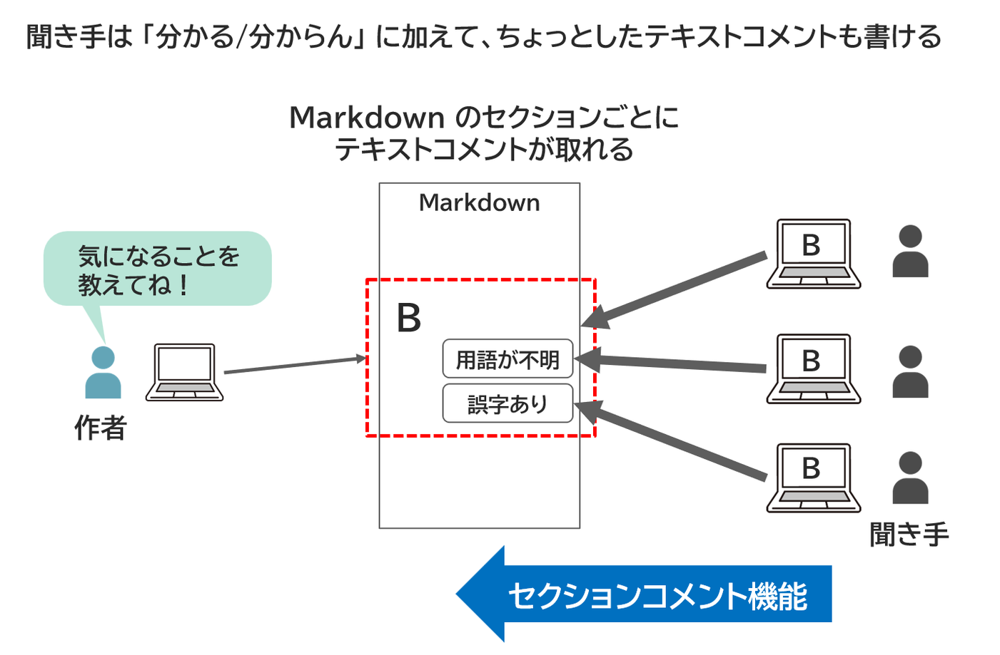

<!-- md_merge_rawtitle: セクション単位でコメントを書ける -->
{{#id:section:マルチステップ機能:slide5}}
## セクション単位でコメントを書ける

フィードバックとしては、ちょっとしたテキストコメントを書いてもらうほうがありがたいときもありますよね。 単に 「分かる/分からない」 だけではなく、

「○○の用語の説明が欲しい」

といった短いコメントがあると助かる、そんなケースがよくあります。

<!-- #steps -->
{ width=100% }
{ width=100% }
{ width=100% }
{ width=100% }
{ width=100% }
<!-- /steps -->

これは 「セクションコメント機能」 と呼んでおきます。