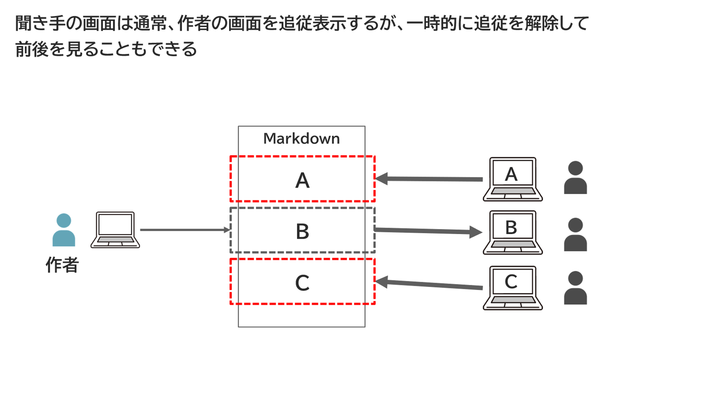
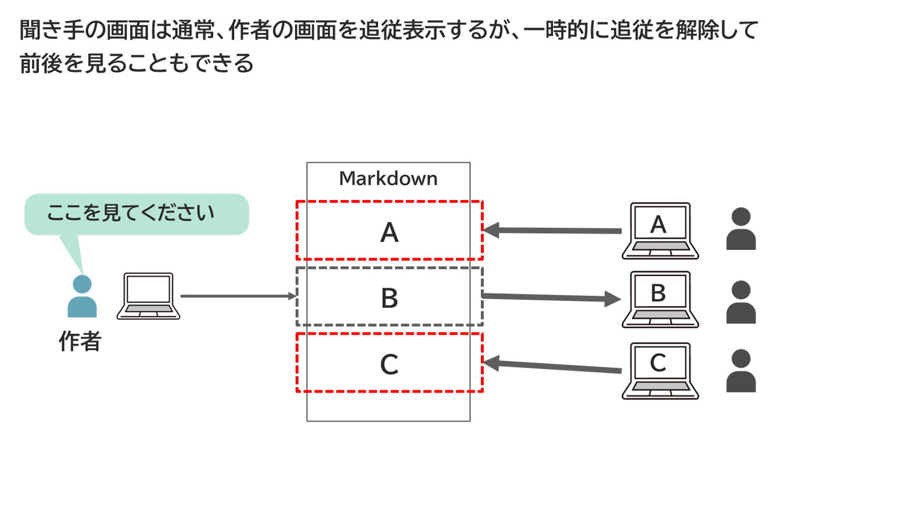
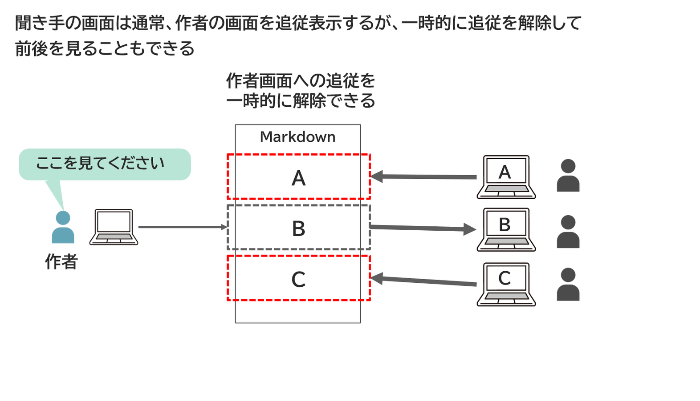
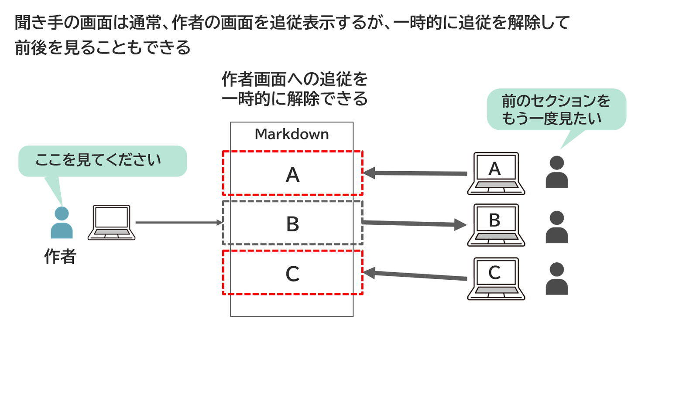
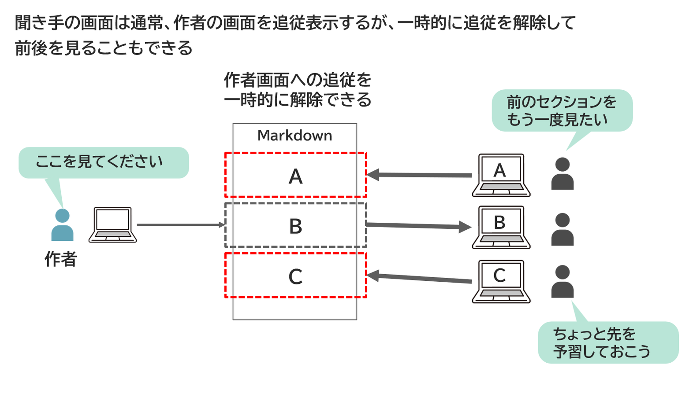
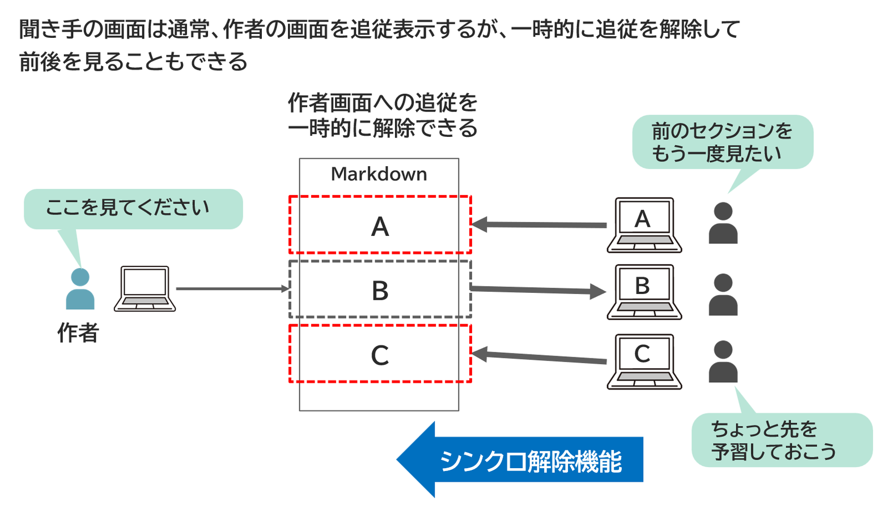

<!-- md_merge_rawtitle: 「ちょっと前の部分を見返す」 こともできる -->
{{#id:section:マルチステップ機能:slide6}}
## 「ちょっと前の部分を見返す」 こともできる

そんな、Markdown 文書を共有してフィードバックを返せるツールにもう一つ欲しいのが、「シンクロ解除」 機能です。

通常は 「シンクロ機能」 によって、作者が指定する画面を表示するものの、必要に応じてそのシンクロを解除して、指定以外のセクションも見られるようにする機能です。

「さっき説明してくれたセクションをもう一度見たい」 「少し先のセクションを見たい」 という場合の他に、「前のセクションでつけたフィードバックを修正したい」というようなときに役立ちます。

<!-- #steps -->
{ width=100% }
{ width=100% }
{ width=100% }
{ width=100% }
{ width=100% }
{ width=100% }
<!-- /steps -->

シンクロ解除は聞き手が随時選択できます。シンクロを戻せば再び作者の指定に同期して表示が変わるようになります。