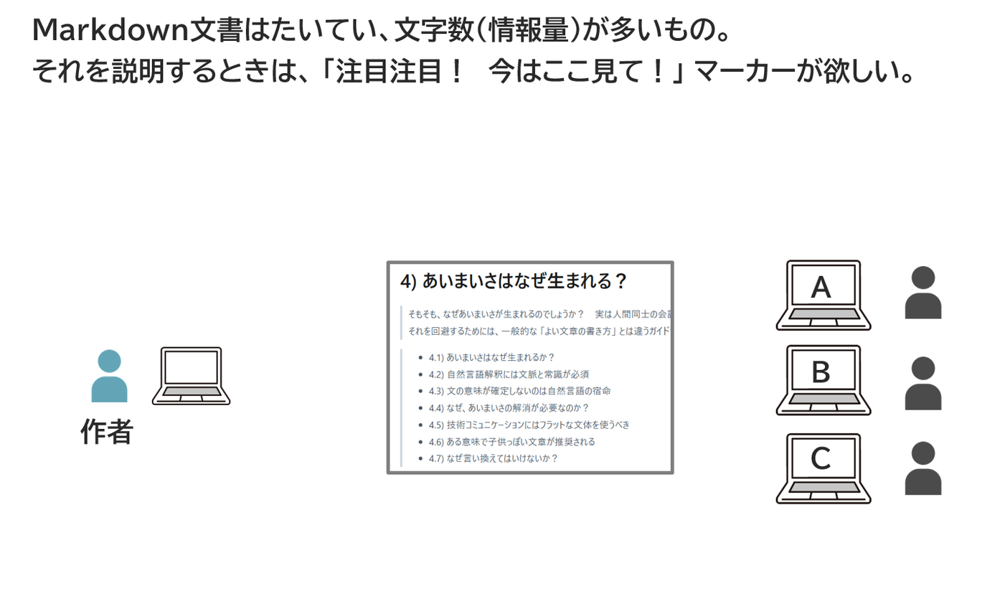
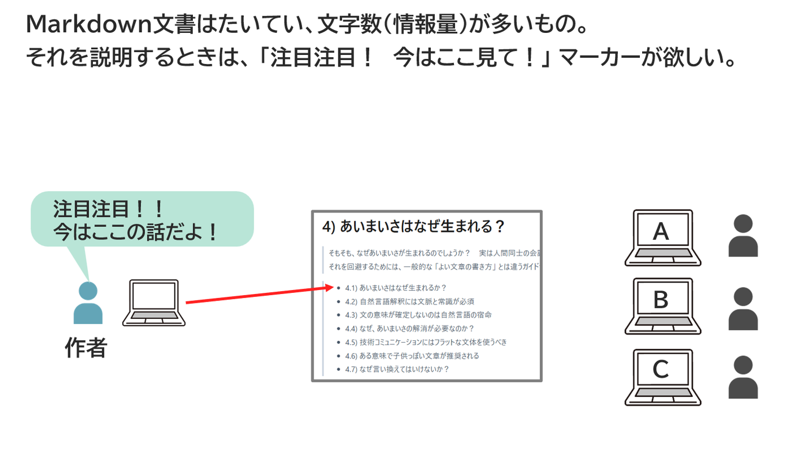
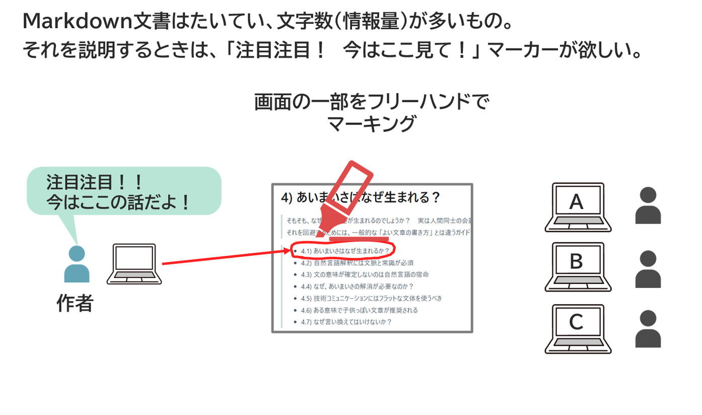
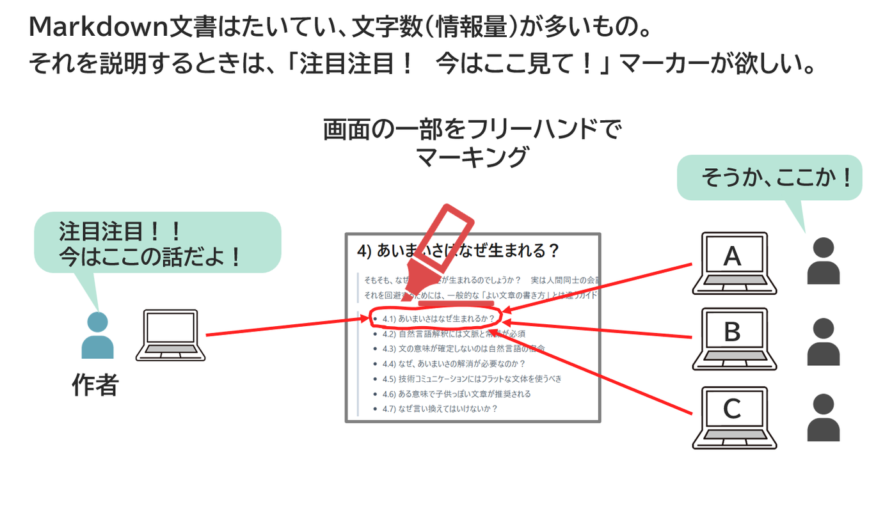
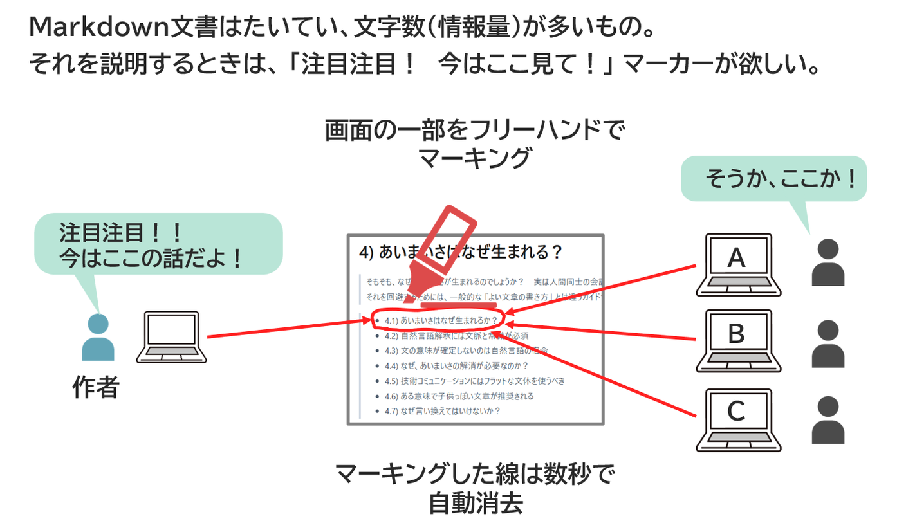
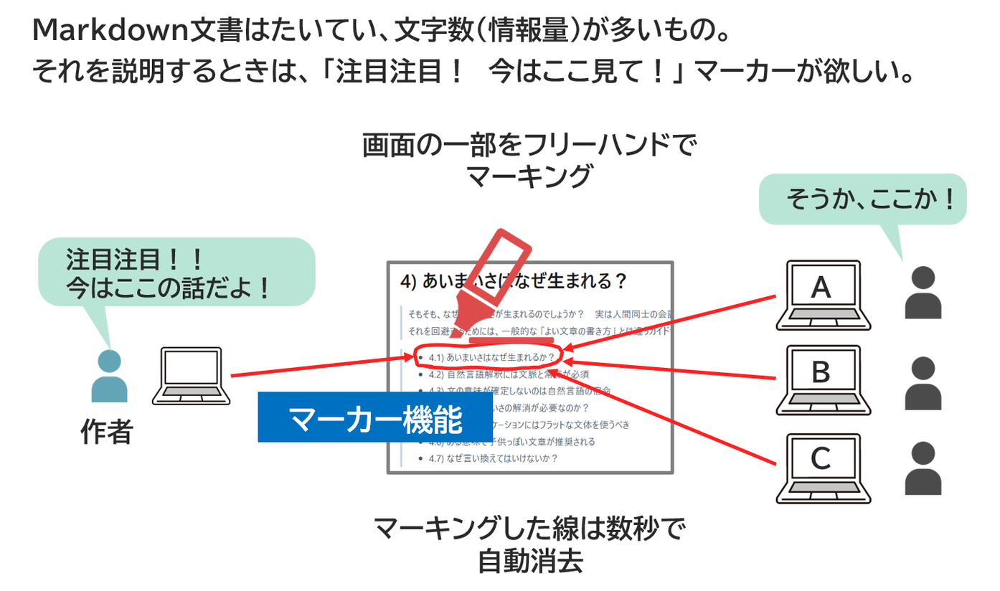

<!-- md_merge_rawtitle: 「ここが重要マーカー」 も欲しいよね？ -->
{{#id:section:マルチステップ機能:slide7}}
## 「ここが重要マーカー」 も欲しいよね？

Markdown で書く文書はたいてい、情報量/文字数が多いものです。そのため、単におおまかに写して口頭説明を加えるだけだと、どこの話をしているのか聞き手が分かりづらくなることがあります。そこで欲しいのがマーカー機能。

元のMarkdown文書には手を加えず、臨時にちょっとしたマーキングをして一部を目立たせる機能です。

<!-- #steps -->
{ width=100% }
{ width=100% }
{ width=100% }
{ width=100% }
{ width=100% }
{ width=100% }
<!-- /steps -->

数秒で自動的に線が消えるように設定できたり、色分けできたりするとなお良いですね。 「数秒で自動消去」 は文書の作者が講習会モードで使用した場合に有効です。　視聴者側で使用した場合は消えません。

また、フリーハンドでのマーキングは画像部分にのみ有効です。MDテキスト部分へのマーキングは、文字単位で背景色がつきます。